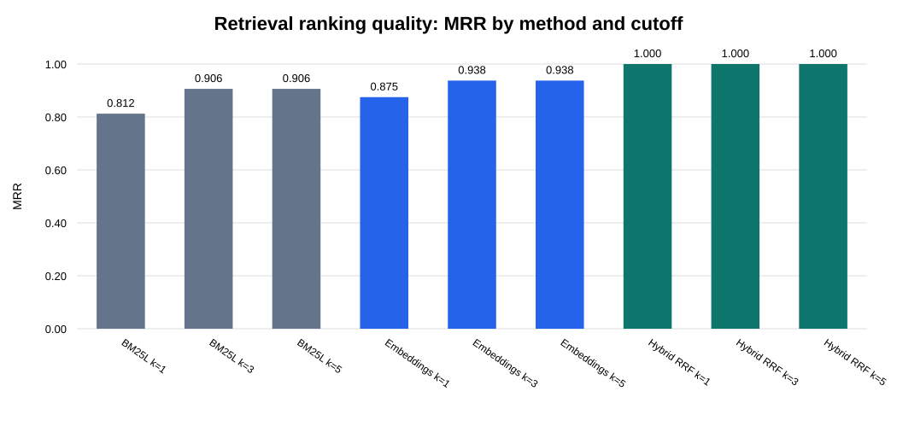
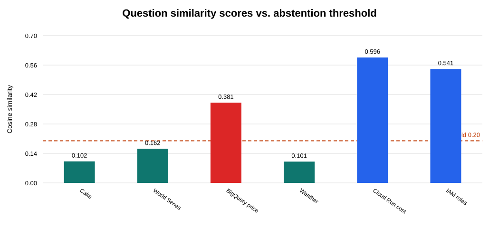

# Local RAG Retrieval Assistant

A local-first, document-grounded retrieval assistant exploring RAG architecture, semantic search, hybrid retrieval, and evaluation using Google Cloud–related documentation.

> **Scope:** This project implements local keyword, semantic, and hybrid retrieval. It displays supporting evidence and evaluates retrieval quality and experimental abstention. It does not integrate Gemini or Argon and does not generate LLM answers.

## Why this project?

Retrieval-Augmented Generation (RAG) systems need to find relevant information before a language model can use it to answer questions. This project explores that retrieval layer and evaluates how different retrieval methods perform on a small, manually labeled document collection.

The implementation is designed to run locally and can use a cached embedding model without network access.

## Architecture

1. **Document ingestion:** Read Markdown and text files from `data/raw/`, split them into chunks, and save the processed collection to `data/processed/chunks.json`.
2. **Keyword retrieval:** Use BM25L to rank passages based on query terms.
3. **Semantic retrieval:** Use `sentence-transformers/all-MiniLM-L6-v2` to create embeddings and rank passages using cosine similarity.
4. **Hybrid retrieval:** Combine keyword and semantic rankings using Reciprocal Rank Fusion (RRF).
5. **Evidence display:** Retrieve the top passages and show their source, chunk ID, and similarity score.
6. **Evaluation:** Compare retrieval methods and test whether a similarity threshold rejects selected out-of-scope questions.

## Project structure

```text
.
├── data/
│   ├── raw/                  # Source documents
│   └── processed/
│       └── chunks.json       # Generated document chunks
├── eval/
│   ├── questions.json        # Labeled retrieval benchmark
│   └── abstention_questions.json
├── reports/
│   └── retrieval_evaluation.md
├── src/
│   ├── ingest.py
│   ├── retrieve.py
│   ├── retrieve_embeddings.py
│   ├── retrieve_hybrid.py
│   ├── query.py
│   ├── evaluate.py
│   ├── compare_cutoffs.py
│   ├── compare_retrievers.py
│   └── evaluate_abstention.py
├── tests/
├── requirements.txt
└── README.md
```

## Requirements

- Python compatible with the installed dependencies
- The `sentence-transformers` model `all-MiniLM-L6-v2`
- No paid API key is required for the current implementation

## Run locally

From the repository root:

```bash
python3 -m venv .venv
source .venv/bin/activate
python -m pip install -r requirements.txt
```

The embedding model must be available in the local Hugging Face cache. Its initial download requires network access if it is not already cached. After the model is cached, run the project in offline mode:

```bash
HF_HUB_OFFLINE=1 TRANSFORMERS_OFFLINE=1 \
python src/ingest.py
```

Ask a question:

```bash
HF_HUB_OFFLINE=1 TRANSFORMERS_OFFLINE=1 \
python src/query.py "How does document ingestion work in RAG?"
```

The CLI displays retrieved evidence rather than a generated natural-language answer.

## Retrieval evaluation

The labeled benchmark contains 16 questions with manually assigned relevant chunk IDs. The experiment compares BM25L, embedding retrieval, and hybrid Reciprocal Rank Fusion (RRF) at different retrieval cutoffs.

### Results

Results from the current 16-question benchmark:

| Method | k | Hit Rate@k | Mean Recall@k | MRR@k |
|---|---:|---:|---:|---:|
| BM25L | 1 | 0.812 | 0.781 | 0.812 |
| BM25L | 3 | 1.000 | 0.969 | 0.906 |
| BM25L | 5 | 1.000 | 1.000 | 0.906 |
| Embeddings | 1 | 0.875 | 0.844 | 0.875 |
| Embeddings | 3 | 1.000 | 0.969 | 0.938 |
| Embeddings | 5 | 1.000 | 1.000 | 0.938 |
| Hybrid RRF | 1 | 1.000 | 0.969 | 1.000 |
| Hybrid RRF | 3 | 1.000 | 0.969 | 1.000 |
| Hybrid RRF | 5 | 1.000 | 1.000 | 1.000 |

**Interpretation:** Hybrid RRF ranked relevant evidence particularly well on this benchmark. These results are encouraging, but the benchmark is small and manually labeled; they do not establish that hybrid retrieval will outperform the alternatives on unseen queries.

### Metric definitions

- **Hit Rate@k:** Fraction of questions for which at least one relevant chunk appears in the top k results.
- **Mean Recall@k:** Average fraction of labeled relevant chunks retrieved in the top k results.
- **MRR@k:** Average reciprocal rank of the first relevant result, with zero contribution when no relevant result appears in the cutoff.

Run the retrieval comparisons:

```bash
python src/evaluate.py
python src/compare_cutoffs.py
HF_HUB_OFFLINE=1 TRANSFORMERS_OFFLINE=1 \
python src/compare_retrievers.py
```

## Abstention experiment

The query interface uses an experimental minimum cosine similarity threshold of `0.20`. Results below this threshold are rejected; results at or above it display retrieved evidence.

On the current four-question out-of-scope probe set:

- Correct abstentions: **3 of 4**
- False acceptances: **1 of 4**
- Out-of-scope rejection rate: **75%**

The BigQuery pricing question was incorrectly accepted because semantically related Cloud documentation produced a score above the threshold. This demonstrates that semantic similarity alone cannot establish whether retrieved evidence contains the information needed to answer a question.

Two additional borderline questions about Cloud Run cost and IAM roles were accepted. Acceptance means only that the score passed the threshold; it does not prove that the retrieved evidence is sufficient.

Run the experiment:

```bash
HF_HUB_OFFLINE=1 TRANSFORMERS_OFFLINE=1 \
python src/evaluate_abstention.py
```

The probe set is small and manually selected. The rejection rate is not a production reliability estimate, and the threshold has not been calibrated on a larger validation set.

## Tests

Run the test suite with the cached model:

```bash
HF_HUB_OFFLINE=1 TRANSFORMERS_OFFLINE=1 \
python -m unittest discover -s tests -v
```

The current suite contains seven tests covering retrieval validation and query behavior, including abstention at the threshold boundary.

Check dependency consistency:

```bash
python -m pip check
```

## Current limitations

- No LLM-based answer generation or hosted model integration.
- No production-grade evaluation dataset; the current benchmark is small and manually labeled.
- The similarity threshold is experimental and does not represent calibrated confidence.
- A high similarity score does not guarantee that the retrieved passages support the requested answer.
- No production deployment, authentication layer, or live data pipeline is implemented.

## Future improvements

- Expand the benchmark with more diverse in-scope and out-of-scope questions.
- Evaluate evidence sufficiency separately from semantic relevance.
- Tune the abstention threshold using a separate validation set.
- Explore answer generation with citations only after retrieval quality and grounding are evaluated.

## License

Add a license before distributing or reusing this project under explicit open-source terms.

## Experiment results

The following reports are generated from the benchmark and evaluation scripts.

### Retrieval comparison



- [Retrieval metrics](reports/retrieval_comparison.md)

### Abstention evaluation



- [Per-question abstention results](reports/abstention_evaluation.md)

On the current four-question out-of-scope probe, 3 questions were rejected and 1 was incorrectly accepted. This small experiment illustrates why semantic similarity alone cannot establish that retrieved evidence answers a question.
